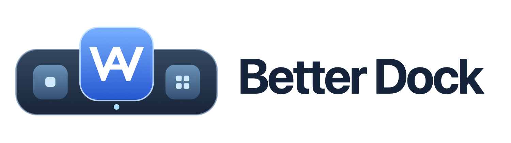

<p align="center">
  
</p>

<p align="center">
  Eine kleine Menüleisten-App, die das macOS-Dock aufräumt.<br>
  <em>A tiny menu bar app that tidies up the macOS Dock.</em>
</p>

<p align="center">
  <a href="../../releases/latest/download/Better-Dock.dmg"><strong>⬇️ Better Dock herunterladen</strong></a>
</p>

## Was die App kann

- **Rechte Dock-Seite ausblenden** – minimierte Fenster und zuletzt benutzte Apps verschwinden aus dem Dock, übrig bleiben nur deine Apps links (und der Papierkorb). Ein Klick oder `⌃⌥⌘D` schaltet um, ein zweiter stellt alles wieder her.
- **App-Ordner im Dock** – mehrere Apps zu einem Ordner zusammenfassen, wie am iPad. Der Ordner sitzt links zwischen deinen Apps, zeigt Mini-Icons und öffnet beim Klick ein Raster mit den Apps.
- **Ordner per Ziehen** – eine App im Dock doppelt drücken (einmal klicken, sofort wieder drücken und halten), dann über einer anderen App kurz hin- und herrütteln: Beide landen zusammen in einem Ordner. Alternativ ruhig darüber halten, bis ein grünes „+1" erscheint, und loslassen. Auf einen bestehenden Ordner gezogen, kommt die App dazu. Ohne Doppeldrücken bleibt Ziehen normales Umsortieren. Braucht die Bedienungshilfen-Berechtigung.
- **Apps wieder herausziehen** – Ordner öffnen, App gedrückt halten (sie wackelt wie am iPad) und aus dem Ordner ziehen. Sie liegt wieder einzeln im Dock; bleibt nur eine App übrig, löst sich der Ordner auf.
- **Beim Anmelden starten** – optional, per Häkchen im Menü.

Better Dock hat kein eigenes Dock-Symbol, sondern sitzt oben rechts in der Menüleiste.

## Installation

1. [Better-Dock.dmg](../../releases/latest/download/Better-Dock.dmg) herunterladen und öffnen.
2. Im Fenster die App nach unten ins gezeichnete Dock ziehen – dort liegt die Verknüpfung zum Ordner **Programme**.
3. Beim ersten Start meldet macOS, dass die App nicht geöffnet werden kann, weil sie nicht von Apple geprüft (notarisiert) ist. Dann:
   **Systemeinstellungen → Datenschutz & Sicherheit → nach unten scrollen → „Dennoch öffnen"**.

   Alternativ im Terminal:

   ```bash
   xattr -dr com.apple.quarantine "/Applications/Better Dock.app"
   ```

4. Für „Ordner per Ziehen" fragt macOS beim ersten Start nach der Bedienungshilfen-Berechtigung – erlauben.

Voraussetzung: macOS 14 oder neuer, Apple Silicon oder Intel.

## Bedienung

Klick auf das Dock-Symbol in der Menüleiste:

| Menüpunkt | Wirkung |
| --- | --- |
| Rechte Dock-Seite ausblenden / einblenden | Schaltet den rechten Dock-Bereich um (auch per `⌃⌥⌘D`) |
| Ordner verwalten… | Fenster zum Anlegen, Benennen und Befüllen von Dock-Ordnern |
| Ordner per Ziehen im Dock erstellen | Schaltet das Zusammenziehen von Apps im Dock ein oder aus (standardmäßig an) |
| Beim Anmelden starten | Startet Better Dock automatisch |

**Ordner anlegen:** „Ordner verwalten…" → mit „+" einen Ordner anlegen → Apps hinzufügen (aus dem Dock, über „Andere App…" oder per Ziehen aus dem Finder) → „Übernehmen". Wird ein Ordner gelöscht, kommen die Apps an ihre alte Stelle im Dock zurück.

## Gut zu wissen

- Bei jeder Änderung startet das Dock kurz neu (etwa eine Sekunde).
- Der Papierkorb bleibt immer sichtbar – macOS lässt ihn nicht entfernen.
- Eine laufende App zeigt macOS weiterhin einzeln im Dock an, auch wenn sie in einem Ordner liegt.
- Das Dock kennt von sich aus kein Aufeinanderziehen: Beim Ziehen weicht die Ziel-App weiterhin zur Seite aus. Better Dock merkt sich das Ziel trotzdem – einfach in ihrer Nähe rütteln oder halten.
- Blendet sich dein Dock automatisch aus, bleibt es nach einer Änderung sichtbar, bis die Maus es verlässt.
- Minimierte Fenster gehen nicht verloren: Rechtsklick auf das App-Symbol oder Mission Control zeigt sie.

## Wie es funktioniert

Better Dock nutzt nur die normalen Dock-Einstellungen von macOS (`com.apple.dock`): `minimize-to-application`, `show-recents` und die Liste der Dock-Apps. Für das Ausblenden und die Ordner ist keine Sonderberechtigung nötig. Nur „Ordner per Ziehen" braucht die Bedienungshilfen-Berechtigung, um die Position der Dock-Symbole zu lesen; die Mausbewegung wird dabei ausschließlich lokal ausgewertet. Zur Fehlersuche schreibt die App ein kleines Protokoll nach `~/Library/Logs/BetterDock.log`; es bleibt auf deinem Mac. Vor der ersten Änderung an der Dock-Belegung legt die App eine Sicherung unter `~/Library/Application Support/awyre/dock-backup.plist` ab.

Jeder Dock-Ordner ist eine winzige Hilfs-App in `~/Applications/Better Dock Ordner/`, die beim Klick das Raster anzeigt.

## Selbst bauen

Benötigt Xcode (Swift 5.9 oder neuer).

```bash
./build.sh install
```

`./build.sh` baut nur, `./build.sh dmg` erzeugt zusätzlich das DMG in `dist/` (richtet dafür einmalig `dmgbuild` in `.venv/` ein).

## Lizenz

[MIT](LICENSE)
